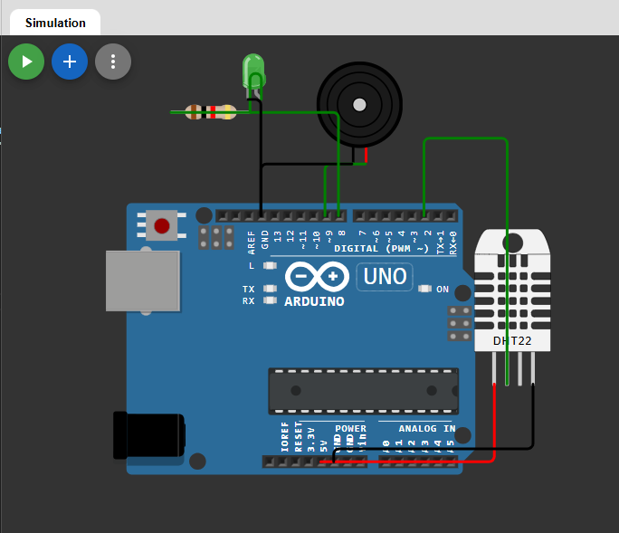
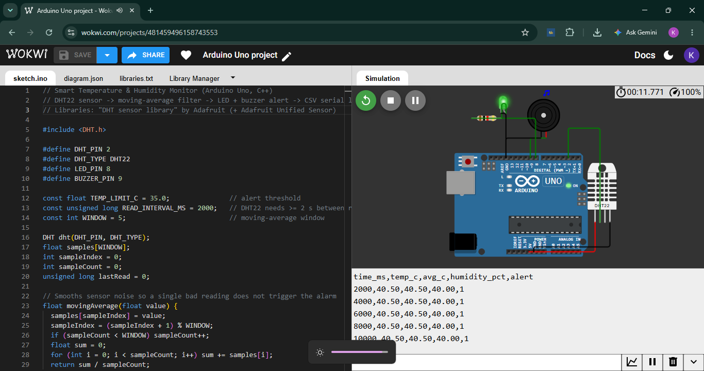

# Smart Temperature & Humidity Monitor (Arduino, C++)

Embedded C++ firmware for an Arduino Uno that reads a DHT22 sensor, smooths the readings, and triggers an LED and buzzer alert when the temperature gets too high. Readings are logged over serial as CSV.

**Simulation:** [Open in Wokwi](https://wokwi.com/projects/481459496158743553)

## Components
- Arduino Uno
- DHT22 temperature and humidity sensor
- LED with a resistor
- Buzzer

## Wiring
| Part | Arduino pin |
|---|---|
| DHT22 VCC / GND / SDA | 5V / GND / D2 |
| LED (through resistor) | D8 |
| Buzzer (+) | D9 |

## How it works
1. Reads temperature and humidity from the DHT22 every 2 seconds.
2. Skips invalid readings (for example, a disconnected sensor) and reports an error over serial.
3. Applies a 5-sample moving average so one noisy reading does not trigger a false alarm.
4. If the average temperature goes above 35 °C, the LED turns on and the buzzer sounds.
5. Logs `time_ms,temp_c,avg_c,humidity_pct,alert` as CSV over serial at 9600 baud.

## Key concepts
- Non-blocking timing with `millis()` instead of `delay()`
- Moving-average filter for sensor noise
- Sensor error handling
- GPIO output and UART serial logging

## Screenshots

- `sketch.ino`: firmware
- `diagram.json`: Wokwi circuit

## Libraries
- DHT sensor library (Adafruit)
- Adafruit Unified Sensor
